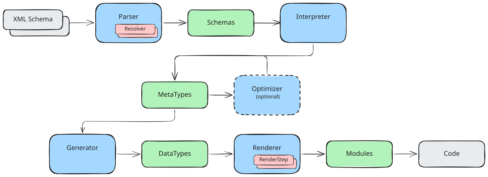

A comprehensive library for parsing XML schemas and generating code based on them.

This project originated as a fork of [`xsd-parser-rs`](https://github.com/lumeohq/xsd-parser-rs) but has since evolved into a complete rewrite.

If you enjoy the project and would like to support my work, you can [buy me a coffee](https://ko-fi.com/bergmann89) or [send a tip via PayPal](https://paypal.me/bergmann891/5EUR). Thanks a lot! 😊

<a href="https://github.com/Bergmann89/xsd-parser/blob/master/LICENSE"></a> <a href="https://crates.io/crates/xsd-parser"></a> <a href="https://crates.io/crates/xsd-parser"></a> <a href="https://docs.rs/xsd-parser"></a> <a href="https://github.com/Bergmann89/xsd-parser/actions/workflows/main.yml"></a> <a href="https://deps.rs/repo/github/Bergmann89/xsd-parser"></a>


# Overview

This library is built around a staged transformation pipeline that converts XML schemas into Rust source code. Each stage handles a specific level of abstraction and produces a well-defined intermediate representation. This makes the library highly flexible, testable, and suitable for advanced customization or tooling.



## Pipeline Stages

1. **Parsing:**
   The parsing stage is handled by the `Parser` type. It loads XML schemas from files or URLs and uses pluggable `Resolver`s to fetch and preprocess schema definitions. The result is captured in a `Schemas` model, which stores namespaces, prefixes, and the raw schema structure needed for further processing.

2. **Interpreting:**:
   Interpreting is carried out by the `Interpreter`. This stage analyzes the schema definitions stored in the `Schemas` model and converts them into normalized, abstract type descriptions. The resulting `MetaTypes` model encapsulates schema semantics such as complex types, enumerations, references, and groups in a language-agnostic form.

3. **Optimizing:**
   Optimization is performed by the `Optimizer`, which takes the `MetaTypes` and applies structural transformations. These include deduplication, simplification of unions, merging cardinalities, and resolving typedef aliases. The goal is to prepare the type graph for idiomatic translation into Rust while reducing complexity.

4. **Generating:**
   The generation step uses the `Generator` to transform the abstract types into Rust-specific type data. It produces the `DataTypes` model by attaching names, Rust derivations, trait support, and rendering metadata. These enriched types form the basis for later rendering while still preserving schema semantics.

5. **Rendering:**
   Rendering is handled by the `Renderer`, which converts `DataTypes` into structured Rust code organized in a `Module`. It uses the `RenderStep` trait to define individual rendering steps. Several built-in steps are available, including support for `serde` or `quick-xml`. Users can also add custom `RenderStep` implementations to extend or modify the output.

## Data Models

- **`Schemas`:**
  This model is built by the `Parser` and contains the raw XML schema data, including namespaces, prefixes, and schema file content. It serves as the foundation for interpretation and supports multiple sources and resolver types.

- **`MetaTypes`:**
  Generated by the `Interpreter`, this model contains language-neutral type definitions. It includes data like complex types, references, enumerations, and groupings derived from schema structure. It is suitable for introspection, transformation, and optimization.

- **`DataTypes`:**
  Produced by the `Generator`, this model holds enriched Rust-specific type data. Each type includes metadata for layout, naming, derivations, and other traits required for rendering idiomatic Rust code. This is the core input for the rendering process.

- **`Module`:**
  The final model is produced by the `Renderer`. It wraps the Rust source code output into a structured format, ready for file output or consumption as token streams. Modules support nested submodules, file splitting, and embedded metadata for customization.


# Features

This library provides the following features:

- **Rust Code Generation:** Convert any XML schema into Rust code.
- **Layered Architecture:** Add user-defined code to manipulate type information or generated code.
- **User-Defined Types:** Inject existing types into the generated code to reuse predefined structures.
- **`serde` Support:** Generate code for serialization and deserialization using [`serde`](https://docs.rs/serde) with [`serde_xml`](https://docs.rs/serde-xml-rs) or [`quick_xml`](https://docs.rs/quick-xml) as serializer/deserializer.
- **`quick_xml` Support:** Direct serialization/deserialization support using [`quick_xml`](https://docs.rs/quick-xml), avoiding `serde` limitations and leveraging asynchronous features. Code generated for very large schemas may need a higher `#![recursion_limit]` (e.g. `256`) in the crate that includes it.


# Getting Started

The usual setup generates the code in the build script of your crate. Add `xsd-parser` as build dependency and `xsd-parser-types` (with the features your generated code needs, e.g. `quick-xml`) as normal dependency:

```toml
[dependencies]
xsd-parser-types = { version = "0.4", features = ["quick-xml"] }

[build-dependencies]
xsd-parser = "1.8"
```

Then generate the code in `build.rs` and include it from your crate:

```rust,no_run
use std::{env, fs, path::PathBuf};

use xsd_parser::{config::Schema, generate, Config, Error};

fn main() -> Result<(), Error> {
    let config = Config::default()
        .with_schema(Schema::File("schema/my-schema.xsd".into()))
        .with_quick_xml();

    let code = generate(config)?;

    let out_dir = PathBuf::from(env::var("OUT_DIR").unwrap());
    fs::write(out_dir.join("my_schema.rs"), code.to_string())?;

    Ok(())
}
```

```rust,ignore
// src/lib.rs
pub mod my_schema {
    include!(concat!(env!("OUT_DIR"), "/my_schema.rs"));
}
```

The examples in [`xsd-parser/examples`](https://github.com/Bergmann89/xsd-parser/tree/master/xsd-parser/examples) and [`examples`](https://github.com/Bergmann89/xsd-parser/tree/master/examples) show more advanced setups, and the feature tests in [`xsd-parser/tests/feature`](https://github.com/Bergmann89/xsd-parser/tree/master/xsd-parser/tests/feature) contain a small schema, the used `Config` and the generated code for almost every feature.

## Common Pitfalls

- **`GeneratorFlags::all()` includes `ADVANCED_ENUMS`:** Advanced enums need the `RenderStep::EnumConstants` render step, otherwise the generated code does not compile (`VALUE_*` constants are missing). Either use `Config::with_advanced_enums`, which adds both, or remove the flag (`GeneratorFlags::all() - GeneratorFlags::ADVANCED_ENUMS`).
- **`InterpreterFlags::all()` includes `WITH_NUM_BIG_INT`:** Unbounded XSD integer types are then generated as `num::BigInt` / `num::BigUint`. Add `num` to your dependencies and enable the `num` feature of `xsd-parser-types` if the types are (de)serialized with `quick-xml`.
- **Features of `xsd-parser-types` must match the render steps:** Code generated with `quick-xml` support needs the `quick-xml` feature (and `async` for the async reader), `serde` support needs the `serde` feature, and the decoding types of `Config::with_base64binary_type` need the `base64` feature.
- **Documents that are not UTF-8:** The `IoReader` and `SliceReader` only accept UTF-8. Use the `DecodingIoReader` of `xsd-parser-types` to read other encodings (detected from the BOM or the XML declaration, sync only), and the `EncodingWriter` to write them. Its `write_document` method writes the value as complete document with a matching XML declaration (the serializers themselves never write a declaration).
- **Unknown elements are rejected by default:** The `quick-xml` deserializer fails on elements that are not part of the schema. Use the `skip_unknown_elements` option of `RenderStep::QuickXmlDeserialize` (or `Config::with_quick_xml_config`) to skip them.
- **Dynamic types without `abstract`:** Types that are only used through `xsi:type` but are not declared as `abstract` must be marked with `Config::with_dynamic_type`, otherwise the derived types are not taken into account.
- **Name conflicts:** If two schema types end up with the same Rust name, the generator returns a `DuplicateTypeName` error. Enable `GeneratorFlags::USE_MODULES` (one module per namespace) or assign custom names (see the `custom_names` and `custom_naming` examples).
- **Very large schemas:** The generated code for large schemas may need a higher `#![recursion_limit]` (e.g. `256`) in the crate that includes it.


# Planned Features

- **Schema-Based Validation:** Generate validators directly from schemas to validate XML data during reading or writing.


# Benchmark

Below you can find a list of some benchmarks for serializing and deserializing different XML documents for different schemas. For more details please have a look to the [`benchmark`](https://github.com/Bergmann89/xsd-parser/blob/master/benchmark/README.md) crate.

| Schema                                | Document              | Engine              | Op          | Min        | Avg        | Mdn        | Max        | Stack     |
|---------------------------------------|-----------------------|---------------------|-------------|------------|------------|------------|------------|-----------|
| XMLSchema                             | XMLSchema             | quick_xml           | serialize   | 364.30 µs  | 382.06 µs  | 377.74 µs  | 488.40 µs  |  12.8 KiB |
| XMLSchema                             | XMLSchema             | quick_xml           | deserialize |   1.71 ms  |   1.74 ms  |   1.74 ms  |   1.84 ms  | 141.6 KiB |
| XMLSchema (boxed)                     | XMLSchema             | quick_xml           | deserialize |   1.62 ms  |   1.65 ms  |   1.64 ms  |   1.78 ms  |  73.8 KiB |
| XMLSchema                             | ONIX_BookProduct_3.1  | quick_xml           | serialize   |   3.42 ms  |   3.49 ms  |   3.47 ms  |   3.95 ms  |  10.0 KiB |
| XMLSchema                             | ONIX_BookProduct_3.1  | quick_xml           | deserialize |  17.89 ms  |  18.44 ms  |  18.32 ms  |  20.65 ms  | 117.3 KiB |
| XMLSchema (boxed)                     | ONIX_BookProduct_3.1  | quick_xml           | deserialize |  16.07 ms  |  16.45 ms  |  16.38 ms  |  18.58 ms  |  67.6 KiB |
| XMLSchema                             | XJustiz 3.4.1 (dabag) | quick_xml           | serialize   |   1.19 ms  |   1.22 ms  |   1.21 ms  |   1.29 ms  |  50.2 KiB |
| XMLSchema                             | XJustiz 3.4.1 (dabag) | quick_xml           | deserialize |   8.29 ms  |   8.51 ms  |   8.41 ms  |   9.77 ms  | 520.1 KiB |
| XMLSchema (boxed)                     | XJustiz 3.4.1 (dabag) | quick_xml           | deserialize |   6.91 ms  |   7.04 ms  |   7.00 ms  |   7.94 ms  | 262.3 KiB |
| iDEAL 3.3.1 Merchant-Acquirer         | merchant-acquirer.xml | quick_xml           | serialize   |   3.60 µs  |   4.00 µs  |   3.90 µs  |   7.54 µs  |     214 B |
| iDEAL 3.3.1 Merchant-Acquirer         | merchant-acquirer.xml | serde (quick_xml)   | serialize   |   2.82 µs  |   3.04 µs  |   2.95 µs  |   4.65 µs  |       0 B |
| iDEAL 3.3.1 Merchant-Acquirer         | merchant-acquirer.xml | serde (xml_rs)      | serialize   |   4.30 µs  |   4.52 µs  |   4.50 µs  |   5.44 µs  |    1014 B |
| iDEAL 3.3.1 Merchant-Acquirer         | merchant-acquirer.xml | quick_xml           | deserialize |  16.70 µs  |  17.57 µs  |  17.17 µs  |  37.88 µs  |  14.5 KiB |
| iDEAL 3.3.1 Merchant-Acquirer (boxed) | merchant-acquirer.xml | quick_xml           | deserialize |  11.61 µs  |  12.09 µs  |  11.87 µs  |  14.66 µs  |   9.9 KiB |
| iDEAL 3.3.1 Merchant-Acquirer         | merchant-acquirer.xml | serde (quick_xml)   | deserialize |   8.59 µs  |   9.15 µs  |   9.02 µs  |  15.09 µs  |   4.7 KiB |
| iDEAL 3.3.1 Merchant-Acquirer         | merchant-acquirer.xml | serde (xml_rs v0.7) | deserialize |  43.31 µs  |  50.66 µs  |  49.08 µs  |  66.58 µs  |   8.9 KiB |

The benchmarks were created on the following system:
- OS:                  Linux (Ubuntu 24.04)
- Kernel:              Linux 7.0.0-43-generic
- CPU Arch:            x86_64
- CPU Brand:           12th Gen Intel(R) Core(TM) i9-12900H
- CPU Vendor:          GenuineIntel
- CPU Cores (logical): 20
- CPU max Frequency:   4900.00 MHz

# Changelog

Below you can find a short list of the most important changes for each released version.

## Version 1.8.0

- **Word-Based Naming**
  The default naming splits names into words itself instead of using Inflector, so digits and plural acronyms stay together (`MP3s` becomes `mp3s` instead of `mp_3s`). `LegacyNaming` keeps the names of version 1.7.

- **New Generator and Renderer Options**
  `GeneratorFlags::USE_TYPE_MODULES` generates one module (and file) per type, `CodeFormat::Pretty` formats the output with `prettyplease` (feature `pretty`), `CustomMeta::with_alias` keeps mapped Rust types as aliases, and `RenderStep::PolymorphicFrom` adds `From` conversions for polymorphic choices.

- **Serde Options**
  The Serde render steps can add `serde_with` adapters for arrays with more than 32 elements and skip `None` values and empty vectors (`Config::with_serde_quick_xml_config`, `Config::with_serde_xml_rs_config`).

- **Fixes**
  Choices created by `OptimizerFlags::CONVERT_DYNAMIC_TO_CHOICE` no longer contain abstract types, and types defined inline at a local element use the element name as default tag.

- **Breaking Changes**
  - The generated names change with the word-based naming (e.g. `content_103` becomes `content103`).
  - The Serde render steps have the new fields `large_arrays`, `skip_none` and `skip_empty_vecs`.
  - `GeneratorFlags::all()` includes `USE_TYPE_MODULES`, use `all() - USE_TYPE_MODULES` to keep the previous layout.
  - A generated type named like a build-in type (e.g. `String`) raises an error unless `BUILD_IN_ABSOLUTE_PATHS` is set.

## Version 1.7.0

- **Stable Names for Merged Content Types**
  Since 1.6.0 complex types share the content types that `OptimizerFlags::REMOVE_DUPLICATES` merged. The shared type got the name of the first owner and an internal counter (e.g. `AncillaryContentDescriptionContent85`) and was defined in the module of that owner. The name is now derived from the schema: copies of the same `xs:group` are merged into a type named like the group (`<Group>Content` if the name is already used), defined in the module of the group, and the content of a base type is shared with its derived types as `<Base>Content`, defined in the module of the base type. Content types of unrelated complex types are not merged anymore.

- **Separate Flags for Types and Content Types**
  `REMOVE_DUPLICATES` is now the combination of the new flags `REMOVE_DUPLICATE_TYPES` and `REMOVE_DUPLICATE_CONTENTS`. Use `OptimizerFlags::all() - OptimizerFlags::REMOVE_DUPLICATE_CONTENTS` to keep one content type per complex type, like in version 1.5.

- **Element Namespaces**
  Referenced elements and attributes, substitution group members, global elements and `xsi:type` values are always namespace-qualified. The namespace of an element is defined by its parent instead of its type, so unqualified elements below a default namespace are written with `xmlns=""`. The components of an `xs:import` without `namespace` are in no namespace.

- **Default Namespace at Runtime**
  `SerializeHelper::with_default_namespace` sets a default namespace for the serializer (`SerializeSync::serialize_with` and friends). Elements in that namespace are written without prefix.

- **Reading Namespaces**
  The deserializers resolve unprefixed element names and `xsi:type` values in the default namespace, and dynamic types accept elements that are named differently from the type (`<pet xsi:type="tns:dog">`).

- **Reading and Writing Other Encodings**
  `xsd-parser-types` 0.4.0 adds the `DecodingIoReader`, which decodes the input based on the BOM or the XML declaration (e.g. `Windows-1251` or `UTF-16`), and the `EncodingWriter`, which encodes the serialized output (`write_document` writes a complete document including the matching XML declaration). Characters that can not be represented in the target encoding are written as numeric character references in text and attribute values. Since the upgrade to `quick-xml` 0.42 the `IoReader` only accepts UTF-8.

- **Breaking Changes**
  - The generated code changes for schemas with merged content types, see above.
  - `GroupMeta` has the new field `group`.
  - The serializers write referenced elements and attributes with their prefix, qualify the default root name of global elements and `xsi:type` values, and write `xmlns=""` for unqualified elements below a default namespace. Documents in the old form are still read, except unprefixed elements below a foreign default namespace.
  - The components of an `xs:import` without `namespace` move to no namespace.
  - Hand-written `WithSerializer` implementations should forward the namespace in `serializer_with_namespace`, hand-written wrappers of dynamic types the name in `Deserializer::init_with_name`.
  - The public variants of `ContentSerializer`, `AnySimpleTypeSerializer` and `NillableSerializer` have a new `namespace` field, and `DeserializeHelper::resolve_local_name` is deprecated in favor of `resolve_element_local_name` and `resolve_attrib_local_name`.

## Version 1.6.0

This release adds proper support for dynamic and abstract types, opt-in skipping of unknown elements and dedicated types for binary data. It also upgrades `quick-xml` to 0.42 and fixes a long list of issues found with real-world schemas. Because `xsd-parser-types` re-exports `quick-xml` types, it gets a new minor version (`0.3.0`). Please have a look at the breaking changes at the end of this section before upgrading.

- **Proper Support for Dynamic and Abstract Types**
  Abstract complex types and types configured as dynamic (`Config::with_dynamic_type`) are now generated as dynamic types, also in combination with substitution groups. The concrete types of a substitution group or a dynamic type use a separate postfix (`Dyn` by default, see `Config::with_dynamic_element_postfix`). The new optimizer flag `MERGE_DYNAMIC_TYPES` stores substitution group members and derived types of the same element in one dynamic type.

- **Opt-In Skipping of Unknown Elements**
  The `quick_xml` deserializer can now skip unknown elements including their whole subtree. The option is enabled with the new `skip_unknown_elements` field of `RenderStep::QuickXmlDeserialize` (or the new parameter of `Config::with_quick_xml_deserialize_config` and `Config::with_quick_xml_config`). Known elements at an unexpected position still fail. Without the option the generated code is unchanged and unknown elements are rejected.

- **Types for `base64` and `hex` Encoded Data**
  `xs:base64Binary` and `xs:hexBinary` are now mapped to the new `Base64String` and `HexString` types of `xsd-parser-types`, which keep the encoded value, instead of `String`. Length facets are now checked against the decoded data instead of the encoded string. The decoding variants `Base64Binary` and `HexBinary` can be used with `Config::with_base64binary_type` and `Config::with_hexbinary_type`.

- **Upgrade to `quick-xml` 0.42**
  `quick-xml` was upgraded from 0.38 to 0.42 (including the fixes for the RustSec DoS advisories of older versions). The byte-based API of `xsd-parser-types` stays as it is, the changes are handled at the `quick-xml` boundary. Input that is not valid UTF-8 is now rejected with an encoding error. The required toolchain was raised to Rust 1.95 and all other dependencies were updated to their latest versions.

- **Custom Generator Code**
  Custom types (`CustomMeta`) can carry a `CustomGenerator` that is executed when the generator processes the type, for example to generate dependent types or to resolve type paths.

- **Helper Functions for Flattened Content**
  The new `RenderStep::ContentHelpers` generates accessor methods for structs with flattened content (e.g. `fn private_note(&self) -> Option<&String>`).

- **Shared Content Types**
  Complex types that use the same content (e.g. through the same `xs:group`) now share one generated content type instead of getting a copy per owner.

- **Configurable Name for Content Fields**
  The name of the generated content field can be changed with `Config::with_content_display_name`, to avoid conflicts with schema attributes or elements called `content`.

- **Better Error Reporting**
  - The interpreter returns errors instead of panicking for types that are missing or not generated yet, and `InterpreterError::NoType` names the affected type
  - The generator returns the new `Error::DuplicateTypeName` if two schema types would be generated with the same name, instead of producing code that does not compile
  - Invalid user provided identifier paths (derives, includes of custom types) return errors instead of panicking
  - File resolver and parser errors now contain the affected file path (`FileResolverError`, `InvalidFilePath`)

- **Additional Bug Fixes**
  - Fixed a panic for derived types that are declared before their base type
  - Fixed a panic in the interpreter for multiple schemas without `RESOLVE_INCLUDES`
  - Fixed `xs:pattern` facets of different derivation steps, they are now combined with AND as required by the XSD specification
  - Fixed substitution group members without a type, they now use the type of their head instead of `xs:anyType`
  - Fixed global attributes without a type, they now use `xs:string` like local attributes
  - Fixed `quick_xml` (de)serialization of newtypes of complex types (`TypedefMode::NewType`)
  - Fixed default values of `xs:element` for simple content types (e.g. extensions of `xs:boolean`)
  - Fixed `quick_xml` deserialization of choices with a group variant followed by an unexpected element, and of mixed choices with leading text
  - Fixed the trait implementation of dynamic types for derived types that are generated before their base
  - Fixed boxing of recursive types through shared content types
  - Fixed `USE_UNRESTRICTED_BASE_TYPE_COMPLEX` for types that restrict an abstract base type
  - Fixed `xmlns` emission for schemas with unqualified elements
  - Fixed `GENERATE_PREFIXES` not assigning the generated prefix to the namespace
  - Fixed the `Default` implementation of defaultable choices with a single option
  - Fixed render steps being added twice by the config helpers
  - `xs:documentation` entries are now rendered as separate paragraphs, and documentation with CRLF line endings is unindented correctly
  - `xsd-parser-types` can be built with the `xml` feature but without `quick-xml`

- **Breaking Changes**
  - `xsd-parser-types` 0.3.0: `quick-xml` types in the public API changed with the upgrade to 0.42. `read_attrib` takes the attribute value as `&str`, the dynamic type name helpers return `Cow<str>`, and `Key::qname`, `Key::prefix_decl`, `Value::namespace` and `Element::qname` return a `Result`.
  - Input that is not valid UTF-8 is rejected by the `quick_xml` deserializer.
  - Building requires a newer compiler, the pinned toolchain was raised from Rust 1.86 to 1.95.
  - `RenderStep::QuickXmlDeserialize` has the new `skip_unknown_elements` field, and `Config::with_quick_xml_deserialize_config` and `Config::with_quick_xml_config` take an additional parameter.
  - `Constrains::patterns` is grouped per derivation step (`Vec<Vec<String>>`), and the generated pattern validation is stricter.
  - `InterpreterError::NoType` carries the identifier of the affected type, and the generator error has the new variant `DuplicateTypeName`.
  - The generated code changes for several schemas: abstract types are generated as dynamic types, content types may be shared between complex types, `xs:base64Binary` and `xs:hexBinary` use the new types, and substitution group members without a type use the type of their head.

## Version 1.5.0

This release introduces several new schema features, a refactored identifier system, improved deserialization, and a range of bug fixes targeting real-world XSD compatibility.

- **Support for `xs:anySimpleType`**
  `xs:anySimpleType` is now handled as a distinct type instead of being silently mapped to `xs:string`. A new `AnySimpleType` runtime type was added to `xsd-parser-types`, and the generator can be configured to use any custom type in its place.

- **Support for `xs:redefine` and `xs:override`**
  The parser and interpreter now support the `xs:redefine` and `xs:override` schema composition mechanisms, enabling proper handling of schemas that redefine or override type definitions from imported schema files.

- **Namespace-Aware Enum Serialization and Deserialization**
  Enum values that carry namespace-prefixed content (e.g., `tns:Sender`) are now correctly serialized and deserialized by resolving the namespace URI at runtime rather than comparing literal prefix strings. This fixes incorrect behavior for enums derived from `xs:QName`-like patterns.

- **Support for Duplicated Type Identifiers Across Schema Files**
  The identifier system was restructured to distinguish between types from different schema files. The previous `Ident` type was split into `TypeIdent`, `NodeIdent`, and `PropertyIdent`. `TypeIdent` now carries a `SchemaId`, enabling correct resolution of types that share a name across multiple schema files.

- **`DerivedTypeMeta` for Naming Conflict Resolution**
  A new `DerivedTypeMeta` structure tracks derived types and their display names within `DynamicMeta`. This resolves naming conflicts that occurred when multiple derived types shared the same name across different schemas (e.g., AIXM schema).

- **Support for Non-Zero Integer Types**
  Integer types with matching XSD constraints can now be mapped to Rust's `NonZero*` types (e.g., `NonZeroU8`, `NonZeroI32`). This is independent of the `WITH_NUM_BIG_INT` feature and can be enabled via generator configuration.

- **Improved Name Generation**
  The `Naming` trait and its built-in implementations were improved to handle more edge cases, including duplicate group names and nested types that previously caused naming collisions in generated code.

- **Anchored Regex Pattern Validation**
  Pattern facets (`xs:pattern`) are now correctly anchored at the start and end (`^...$`) as required by the XSD specification. Additionally, patterns with alternation are wrapped in a non-capturing group to prevent partial anchoring issues.

- **Improved `quick_xml` Deserialization**
  The `quick_xml` deserializer received a comprehensive overhaul, improving correctness for complex schema patterns such as dynamic types, mixed content, and deeply nested structures.

- **New Examples and Benchmarks**
  - Added a `BPMN 2.0` example project
  - Added a `VSME` schema example project
  - Added memory usage and performance benchmarks to the `benchmark` crate

- **Additional Bug Fixes**
  - Fixed edge case in `quick_xml` deserialization of simple list types
  - Fixed namespace serialization for the `Element` type
  - Fixed list deserialization when using non-whitespace separators
  - Fixed invalid character escaping when deserializing XML attributes
  - Fixed naming collision for group types reused across inheritance hierarchies
  - Fixed `WithNamespaceTrait` generating conflicting implementations for type aliases
  - Fixed empty list handling (previously reported as an error)
  - Fixed a typo in the `with_element_type_postfix` setter method

## Version 1.4.0

This release focuses on extending customization options, improving `quick_xml` serialization/deserialization, and restructuring the crate into a more modular form. It also includes numerous fixes for naming, type handling, and schema interpretation issues found in real-world XSDs.

- **Customizable Name Generation**
  The entire naming system has been reworked to allow full customization of how identifiers are formatted and generated. This includes support for handling reserved keywords, resolving name collisions, and providing user-defined naming strategies.

- **Crate Split into `xsd-parser` and `xsd-parser-types`**
  The library is now split into two crates. All runtime types and dependencies were moved into `xsd-parser-types`, reducing dependency overhead for users of the generator and improving compatibility with downstream projects.

- **Improved `quick_xml` Serializer/Deserializer**
  The `quick_xml` backend received a comprehensive refactor. Namespace serialization has been improved, state naming is simplified, async reading tests were added, and multiple edge cases involving `xs:any`, `xs:anyType`, CDATA, mixed content, and boxed types are now handled correctly.

- **Extended Interpreter and Generator Capabilities**
  Several complex schema patterns are now correctly interpreted and rendered:
  - complex/simple content combinations with mixed or emptyable bases
  - extended types with mixed content
  - facets applied to enums, unions, and simple types
  - improved handling of `xs:any`, `xs:anyAttribute`, and custom XML runtime types
  - unified configuration for XML helper types
  - new optimizer step to replace `xs:anyType` with `AnyElement` where appropriate

- **Absolute Path Support Improvements**
  Both `GeneratorFlags::BUILD_IN_ABSOLUTE_PATHS` and the new `GeneratorFlags::ABSOLUTE_PATHS_INSTEAD_USINGS` flag now ensure that all built-in types and traits are resolved using absolute paths, reducing the risk of naming conflicts.

- **Additional improvements include**
  - faster loop detection for large schemas resulting in better performance while code generation
  - improved namespace handling and prefix resolution
  - more reliable display names during serialization
  - fixes for mixed choices, nested `xs:any`, substitution groups, and enum/union facets
  - updated schema definitions and expanded test coverage

## Version 1.3

This release introduces new configuration options, enhanced schema modularization, extended type handling, improved serializer support, and broader schema compatibility. It also addresses a range of long-standing issues with stability and schema validation.

- **New Examples and Customization Options**
  An example for custom named enum variants has been added, showcasing how to override generated names with user-defined ones.
  The renderer context was refactored and expanded with helper methods, giving developers more control over schema-level configuration and code generation behavior.

- **Schema Modularization**
  Generated code can now be split into modules per schema definition. This improves maintainability and separation of concerns when working with large or multi-schema projects.
  Meta information is now attached to schemas, making it easier to inspect and debug schema processing.

- **Support for Additional Schemas**
  Support for the OFD schema was added to the test suite, expanding real-world coverage.
  Compatibility with the ONIX schema was introduced, ensuring support for publishing and book-industry data standards.

- **Extended Type Handling**
  A new option allows the use of the full path for built-in types, ensuring unambiguous references in complex projects.
  A new `models::data::TagName` type was introduced to provide consistent and reliable handling of XML tag names across the pipeline.
  Inline element types are now lazily interpreted, reducing memory usage and improving performance for large schemas.
  Restrictions expressed through `xs:facet` are now evaluated and applied to simple type definitions, closing a gap in schema validation support.

- **Improved Serializer Support**
  A new configuration for the `quick_xml` serializer has been implemented, making it possible to fine-tune serialization behavior.
  Existing schema tests were updated to use the new serializer configuration, ensuring consistent results across different serializers.

- **Bug Fixes and Stability Improvements**
  - Fixed escaping and unescaping of mixed content and special characters
  - Resolved interpreter errors with self-referencing types
  - Fixed duplicate type names generated when an attribute named `Type` was present
  - Corrected deserialization failures for XML with `elementFormDefault=qualified`
  - Included schemas now properly inherit their target namespace instead of defaulting incorrectly
  - Restored missing integration tests and expanded coverage for real-world scenarios

## Version 1.2

This release introduces a series of architectural improvements, enhanced flexibility in code generation, and broader schema compatibility.

- **Refactored Pipeline Structure**
  The internal code generation pipeline has been refactored to introduce a new `Renderer` step and an accompanying `DataType` model. This separation gives users more control over the rendering process, allows better extension points for customization, and prepares the architecture for further growth.

- **Refactored Serde Support**
  Support for `serde` has been moved into dedicated renderer steps. This makes it possible to support multiple versions of `serde`-based implementations, such as `serde-xml-rs` 0.7 and 0.8, without mixing code. Each renderer step now cleanly encapsulates the logic for one serialization backend.

- **Implement Support for Unstructured Data**
  Added support for `xs:any` and `xs:anyAttribute` by introducing an internal representation for unstructured XML data. This enables working with flexible or unknown schema elements and fixes a long-standing gap in schema coverage.

- **Implement Support for `BigInt` and `BigUint`**
  Schemas defining integer types without upper bounds can now be mapped to `num::BigInt` or `num::BigUint`, depending on context. This is useful when working with large numeric values.

- **Improved Documentation Support**
  XSD annotations (`xs:documentation`) are now parsed and included as Rust doc comments in the generated code, improving type-level visibility and usability.

- **Different Bug Fixes and Improvements**
  - Enum restrictions on text types are now correctly interpreted and rendered
  - Complex types in the XML Catalog schema are now rendered correctly
  - Introduced per-type `derive` settings for advanced customization
  - Various naming, escaping, and formatting issues were resolved across the pipeline.
  - Generated names of nested elements now uses the name of the parent element as prefix to prevent name collisions.

## Version 1.1

- Implemented feature to generated boxed `quick_xml` deserializers to reduce stack usage during deserialization
- Improved naming of the generated types
- Implemented feature to split generated code into multiple module files
- Improved and implemented advanced examples
- General bug fixes and improvements

## Version 1.0

- First official release of `xsd-parser`


# License

This crate is licensed under the MIT License.
